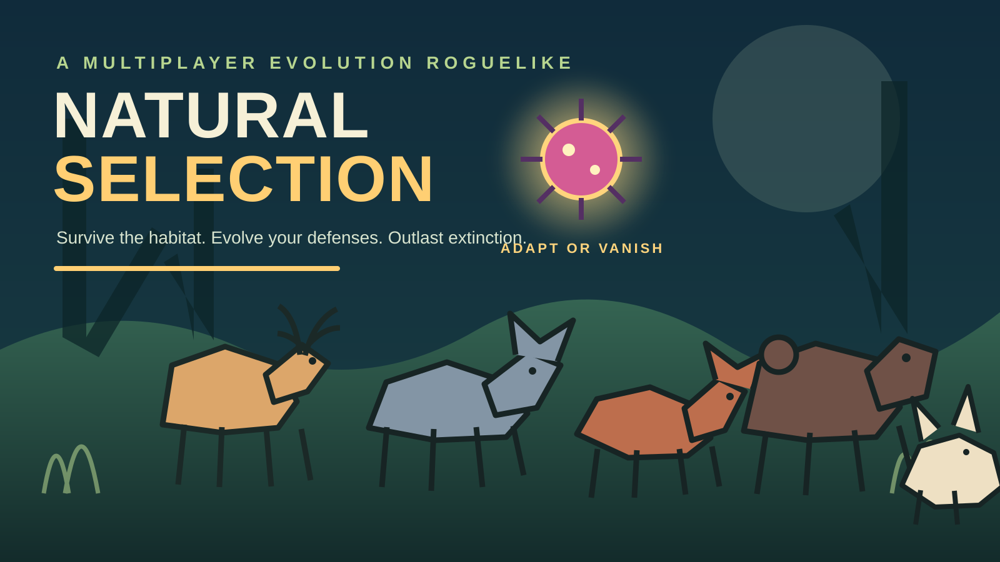

# Natural Selection



Natural Selection is a small authoritative multiplayer survival prototype for the Handshake AI Skills Studio x OpenAI Multiplayer Game Challenge.

The first vertical slice focuses on the defining loop: animals gather resources and compete, defeated animals become disease players, disease players spread infections, and the server resolves animal or extinction victories. Players can choose a deer, wolf, fox, bear, or rabbit, see readable animal and disease artwork in the arena, and move with arrow keys, WASD, or the on-screen pad.

## Run locally

```powershell
node server.js
```

Open <http://localhost:3000> in two browser windows. Choose a deer or wolf, create a lobby in one window, join with the room code in the other, ready both players, and start the match. Use arrow keys or WASD to move.

## Test

```powershell
npm test
```

## Public deployment

The repository includes a Render Blueprint in `render.yaml`. Render can run the frontend and authoritative multiplayer server as one Node web service, assign a public `onrender.com` URL, and terminate HTTPS at the edge.

Deployment handoff:

1. Put this repository in a GitHub repository and push the project files.
2. In Render, choose **New > Blueprint**, connect the repository, and apply `render.yaml`.
3. Wait for the `/healthz` check to pass, then open the generated HTTPS URL.
4. Test from two devices or networks.

This MVP stores lobbies in memory. A deploy or server restart ends active matches, so persistent match recovery is still a pre-submission limitation.

## Netlify package

`netlify-ready-game.zip` is a drag-and-drop package for Netlify. It keeps the same game rules, stores lobby snapshots in a strongly consistent Netlify Blobs store, and polls the function for state updates because serverless functions cannot hold the Render SSE connection open. The package includes `netlify.toml`, `netlify/functions/game.ts`, `package.json`, `package-lock.json`, and the static frontend; it does not include `node_modules`.

## Architecture

- `server.js` serves the client and exposes the lobby/game HTTP API plus Server-Sent Events for live state updates.
- `game.js` contains the authoritative, dependency-free game rules and state transitions.
- `public/` contains the playable browser client.
- `docs/` contains the game design and competition checklist.
- `docs/competition-demo-script.md` contains the short demo narration and capture checklist.
- `docs/qa-run.md` contains the browser and physical-device QA handoff.

The arena uses lightweight vector canvas art for deer, wolves, foxes, bears, rabbits, illustrated food/water/energy nodes, and named diseases including Rabies, Plague, Anthrax, and Smallpox. These are fictional game mechanics and visual labels, not medical guidance.

Server-Sent Events keep the first build simple and reliable: clients submit intent through HTTP, while the server owns movement, damage, infection, mutations, role changes, and victory checks. A WebSocket transport can be introduced later without changing the game rules module.

## Current scope

This is an MVP foundation, not the final competition build. It intentionally uses guest identities, in-memory matches, one arena, a small mutation pool, and a compact action set. Production deployment still needs a hosted server, persistence or recovery strategy, HTTPS, abuse controls, and multi-session QA.
